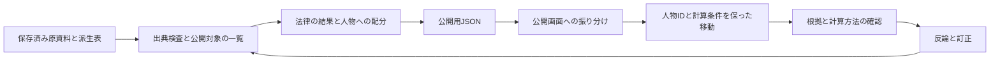

# 実機確認に向けた修正と全体地図

## 今回の範囲

2026-10-29の調査で再現した5件を、採用済みの評価方法に沿って修復します。計算式、しきい値、既定のつまみ、参考額を順位へ足さない境界は変更しません。投票期間・比較分母の修復は既存のプルリクエスト24が担当しており、この変更には混ぜません。

## 全体地図

公開用の法律一覧と、配分へ使う対象は同じ集合を使います。実在画面、架空デモ、非公開の評価入口は混在させません。人物を開く操作では、画面に表示した金額と同じ計算条件を維持します。計算方法の画面と文書の清書は、既存の仕様定義を正本にします。

## 修正した点

| 対象 | 修正 | 確認方法 |
|---|---|---|
| 公開トップ | 一般の付加文字列で架空デモへ落ちない | 通常のトップと計測用文字列付きのトップが同じ実在画面になる |
| 人物指定 | 明示した人物IDを側・政党の絞り込みより優先 | 反対側の人物への移動、直接URL、指定解除での復帰 |
| 人物リンク | 現在の算定条件と表示側を引き継ぐ | 1位カード・棒グラフ・全議員のリンクと履歴復元 |
| 配分対象 | 公開集合を共有観測の分母とすべての配分へ適用 | 空集合、1法律の除外、各帳簿と残る額の再計算 |
| 計算方法 | 段階1・低の採用と参考用の別欄を現行説明へ反映 | 画面と清書の一致、採用済みの設計決定0014との照合 |

## 手元で試す操作

1. 公開用ビルドを開き、トップと`/?utm_source=share`の双方が実在議員画面になることを確認します。公開版の`/demo`と非公開評価の入口は開かないままです。
2. 国士側から、損失側の人物の棒を選びます。同じ人物のカードを開けることを確認します。人物指定を解除すると、それまでの絞り込みへ戻ります。
3. 帰属率などのつまみを変更し、冒頭の1位カードから人物へ進みます。URLの条件と金額が変わらないこと、戻る操作で条件を復元できることを確認します。
4. 全議員の参考欄から、確かな額の順位へ移ります。条件を保ち、参考額を確かな順位へ加えていないことを確認します。
5. 計算方法で、段階1の額を確かさ「低」として扱うこと、参考額は別欄へ配分することを確認します。

## 検証記録

- 修正前の回帰失敗を確認し、回帰テストを実装修正より先のコミットへ保存しました。
- 画面の対象13テストと配分の対象10テストが成功。独立した差分レビューに指摘はありません。
- 全体検査は60ファイル・572テスト成功、既存の省略2件。型検査、公開用ビルド、依存監査は成功し、脆弱性は0件です。
- 議員配布の出典検査は190項目・不一致0件。主要配分は法律63本・人物691人のままで、主要・参考の公開値は来歴ハッシュを除いて修正前と一致します。
- 公開用ビルドは、参考配分を生成して既存の配り先CSVを独立検査へ渡します。同じ配分を検査のために再生成する重複を解消し、検査は省略していません。この接続後のビルドも成功しました。小さい架空入力のビルド検査でも、正常系・額の不一致・許可外の項目・参考配分の不一致を確認し、各実行の参考配分生成が1回であることを検査しています。
- 手元のブラウザで、計測用文字列付きトップの実在画面、国士側から損失側の人物を選ぶ操作、計算条件付きの人物リンクと表示額の維持、人物指定を解除した後の絞り込み復帰を確認しました。
- 本番の反映と、まだ操作していない経路は別に確認します。自動検査の成功をサイト全体の完成とは扱いません。
