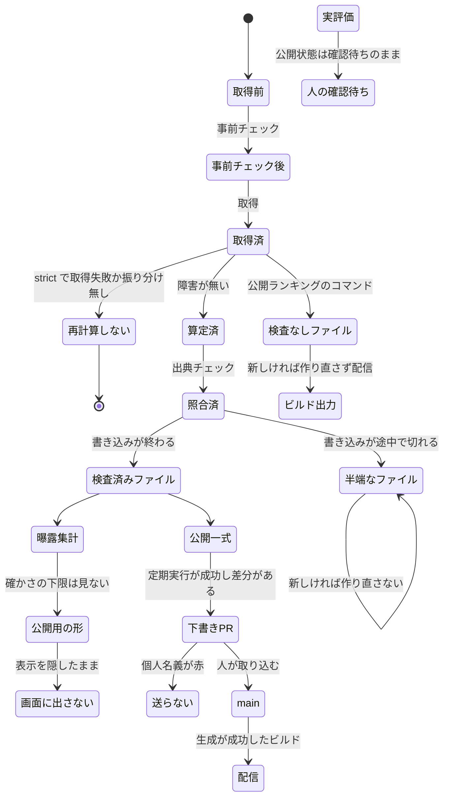

# 評価エンジンの状態図

2026-11-20。挙動は変えていない。コードにある遷移を図にし、公開前検査と中断時の安全性を TLA+ で検査した。食い違いは再現する試験と優先度だけを残す。直すのは別の変更にする。

対象は、資料の取り込みから算定、出典チェック、議員ページの安全検査、個人名義検査、公開データの生成、公開まで。照らした正本はロードマップの G5・G6、R11、設計決定0008・0027・0028。

## 三つの問いへの答え

1. 行き止まりは1つある。公開ランキングの書き込みが途中で切れると、そのファイルは入力より新しくなり、次の生成が直さない。TLC はこの状態をデッドロックとして出す。振り分けが無い成立法で strict の再計算を止める枝は、次の実行で振り分けが付けば戻れるので、行き止まりではない。議員ページの許可リスト検査は、名指しされたファイルが無く、到達できない。
2. 検査を通っていない額が、公開ビルドの出力に残る経路が1つある。`build_public_ranking` のコマンドは今の中身を出典チェックせずに `ranking.json` を書き、`generate_artifacts` はそのファイルが入力より新しければ作り直さない。クリーンな git からの生成は、ファイルが無いので出典チェック付きの生成を通る。確かさが中未満の法律は、曝露の公開用の額には入る。画面はそのファイルをまだ読まない。
3. 途中で切れた `ranking.json` は、前の完全な中身を残さない。配信そのものには進まない。法律一覧の生成が壊れた JSON で落ち、そのビルドは配信されない。ファイルは置き場に残る。

実評価（`evaluateEvidence`）は、結果の公開状態が常に人の確認待ちで、公開ディレクトリへ書く遷移が無い。この部分は上の経路に入らない。

法律ランキングが確かさ「低」の額を、印を付けて載せるのは設計決定0008 の公開である。順位の区画が「参考」だけを分けるのは `law-ranking-view.ts` の実装どおり。ここは食い違いとして数えない。

## 状態図



`半端なファイル` の自己遷移は、出る遷移が無いことを示す。`実評価` から `配信` へは矢印が無い。`公開用の形` から `配信` へも矢印が無い。ファイルは公開ディレクトリに置かない。

## 状態と遷移のありか

| 状態または遷移 | コード |
|---|---|
| 事前チェックのあとでなければ再計算しない | `scripts/daily_update.py` 402-423 行。`ok` が偽なら `rebuild` を呼ばない |
| 事前チェックが赤でも取得は走る | 同 412-413 行。`args.fetch` は `preflight_ok` を見ない |
| strict で取得失敗か振り分け無しなら再計算しない | 同 354-366 行、419-422 行。週2回の workflow は `--strict`（`.github/workflows/weekly-update.yml` 93 行） |
| 再計算が落ちたら定期実行は PR を出さない | `weekly-update.yml` 100-103 行。ジョブが非0で終わる |
| 算定から出典チェック、不一致は額を外して書く | `scripts/source_check.py` 408-414 行、417-426 行。不一致の法律は `scripts/build_public_ranking.py` 547-548 行で額なしへ移す |
| 不一致でも再計算の続きは止まらない | `scripts/rebuild_public.py` 95-100 行。記録は「外した」で、戻り値は見ない |
| 一次資料の URL が無い法律は、書く前に例外 | `scripts/build_public_ranking.py` 171-186 行 |
| 公開ランキングのコマンドは照合せずに書く | 同 595-603 行。`build` は 497 行で前回の `heldOut`（134-137 行）を使う。手順の記述は `docs/deploy-vercel.md` 51 行 |
| 入力より新しければ生成を飛ばす | `scripts/generate_artifacts.py` 75-81 行 |
| 書き込みは置き換えではない | `scripts/source_check.py` 426 行と 441 行。`Path.write_text` |
| 週2回の生成順 | `generate_artifacts.py` 27-40 行。`app/package.json` の `prebuild` がビルドの前に同じ入口を呼ぶ |
| 個人名義は push の前 | `weekly-update.yml` 71-75 行（config）、126-128 行（commit のあと check、push の前） |
| 議員の公開用の額 | `app/src/exposure-inputs.ts` 113-124 行は `結果=額` だけを見る。下限は `app/src/scoring-types.ts` 29-33 行の因果の点だけ |
| 公開用に額を伏せる検査は、書く前に落ちる | `scripts/build_exposure_ranking.mjs` 89-127 行、219-221 行 |
| そのファイルは公開ディレクトリに置かず、画面は読まない | `generate_artifacts.py` 31-33 行。`app/src/MembersPage.tsx` 17-18 行、28 行 |
| 実評価は確認待ちのまま | `app/src/evidence-evaluation.ts` 22 行、148 行。`app/src/evaluation-stage.ts` 5-10 行は公開承認を導出しない |
| 架空の順位計算は実データで動かない | `app/src/ranking.ts` 47-49 行 |
| G5 の数 | `scripts/roadmap_check.py` 160-162 行。数えるのは `release_check.py`、`source_check.py`、`.repo-preflight/hooks`、`preflight.py` |
| G5 の文と R11 が名指しする検査 | `docs/ロードマップ.md` の G5 と R11。`docs/adr/0008-publish-everything-with-certainty-marks.md` 17 行、29 行。ファイル `tests/test_public_members_safety.py` は無い |
| G6 の定期実行 | `.github/workflows/weekly-update.yml` 12-14 行（日曜・水曜 18:00 UTC）。訂正の窓口は `docs/corrections.md` と `.github/ISSUE_TEMPLATE/correction.yml` |

定期実行は `--test` を付けない。`docs/自動更新.md` の表にある「検査」の段は、この workflow には無い。`GITHUB_TOKEN` で作った PR は、同じファイルの 9-10 行のとおり、他の workflow を自動では起こさない。

## TLA+

仕様は `formal/tla/HyokaEngine.tla`。設定は `formal/tla/HyokaEngine.cfg`。TLC は VM で動いた（TLC2 Version 2026.11.19.180144、Java 21）。モデルは1回の公開のファイルの出方だけを持つ。法律の本数、額、取得先の通信は持たない。

設定ファイルが検査するのは、成り立つ方の不変条件である。`published` が半端な値にならないこと。照合済みとして配信したファイルは照合済みのままであること。この実行はデッドロック検査を外してあり、状態グラフを最後まで数える。

```sh
java -cp tla2tools.jar tlc2.TLC -workers 1 -deadlock -config formal/tla/HyokaEngine.cfg formal/tla/HyokaEngine.tla
```

結果は、誤りなし。生成 20、異なる状態 13、探索の深さ 6。出次数の最小は 0 で、行き止まりの状態がグラフに含まれる。

破れる不変条件は、同じ設定に `-inv` を足して別々に検査した。

| 性質 | 結果 | 最短の経路 |
|---|---|---|
| `NoUncheckedPublished`。配信は照合済みのファイルだけ | 違反。生成 7、異なる状態 7、深さ 4 | 取得 → 検査なしで書く → 新しければ配信する |
| `NoPartialRemains`。公開ファイルが途中で切れたまま残らない | 違反。生成 9、異なる状態 9、深さ 5 | 取得 → 算定 → 出典チェック → 書き込みが途中で切れる |
| `NoPartialPublished`。切れたファイルは配信しない | 成り立つ（上の全状態 13 の実行） | 配信のアクションは完全なファイルだけを対象にする |
| デッドロックが無い | 違反。最初の経路は上の「途中で切れる」と同じ5状態。生成 14、異なる状態 12 で停止 | 切れたファイルから出るアクションが無い |

デッドロック検査を外した実行の出次数の最小が 0 なので、行き止まりは半端なファイルだけではない。検査なしのファイルを配信したあと、phase が照合済みまで進むと、そこからも出られない。TLC は幅優先で、先に半端なファイルの行き止まりを報告する。

議員の画面を配信するアクションは仕様に置いていない。`MEMBER_RANKING_HIDDEN` が真のあいだ、その遷移は実行されない。このため TLC は「確かさの下限を通らない額が画面に出る」を違反として出せない。その事実は下の試験がコードで再現する。

## 食い違い

優先度は、公開ビルドの出力に検査なしの額が残るものを P1、ファイルは壊れるが配信には進まないもの、画面の手前で止まっているもの、到達できない検査を P2 にした。P3 は無い。

| 優先度 | 件数 | 原因 |
|---|---|---|
| P1 | 1 | `build_public_ranking.main` が今の出典チェックを通さずに `ranking.json` を書き、`generate_artifacts` が入力より新しいファイルを作り直さない。次のビルドがそのファイルを配信する |
| P2 | 1 | `source_check` の `write_text` は、新しい中身が揃う前にファイルを空にする。途中で切れると半端な JSON が残り、同じ新しさ判定が直さない。法律一覧の生成が落ちるので、そのビルドは配信されない |
| P2 | 1 | 曝露の入力は `結果=額` の法律を確かさに関係なく数える。下限「中」は因果の点（`makeLawEffect`）にだけ掛かる。公開用の額を作る段には無い。画面は隠したままなので、今の配信先には出ない |
| P2 | 1 | `tests/test_public_members_safety.py` が無い。G5 の数は別の4ファイルを数えるので、R11 と設計決定0008 が名指しする許可リスト検査に到達できない |
| P3 | 0 | |

再現は次の試験。どちらも、望む振る舞いを書いてあり、今のコードでは失敗する。通るようになったら印を外す。

- `tests/test_hyoka_publish_gates.py` の4件。`@unittest.expectedFailure`
- `app/src/exposure-inputs.test.ts` の `it.fails`（確かさが中未満の法律は公開用の曝露の額に入らない）

## モデルが省略したこと

- 取得先ごとの「届かない」「飛ばした」と、届かない日に手元だけで伏せ直す段。通信の失敗そのものは、strict のとき再計算に進まない、として上の表に含めた。
- 出典チェックの項目ごとの式。不一致の額を外すことと、外してもジョブを止めないことだけを入れた。
- 曝露の階層・伏せる額の検査。書く前に終了コード1になることは、上の表の行で確認した。TLC の状態には入れていない。
- クリーンな checkout では `ranking.json` が git に無く、生成が出典チェックを通る。P1 は、ファイルが既にある作業ツリーで次のビルドを走らせたときの経路である。
