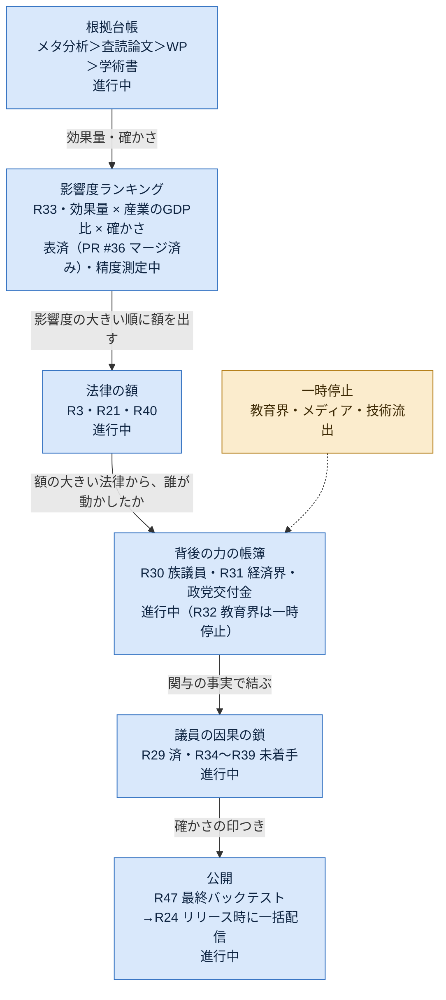

# ロードマップ：リポジトリのゴールまで

更新日：2026-10-23（4判断の表記、国際比較28本の内訳、就業者GDPの公開実施。確かな額73は 2026-10-18 の歴史値）。このファイルがロードマップの正本。共有フォルダの `analysis/ロードマップ_実データ公開まで_2026-10-17.md` は履歴として残す。項目の表は `scripts/roadmap_check.py` が検査する（担当と状態が空の行、根拠の無い「済」を落とす）。

## ゴール

目的（上位）：経済に影響できる権力のうち、中心である国会と国会議員を主軸に、過去50〜60年の日本の停滞を、技術を阻んだ規制・団体・議員に帰属させ、他国比較の反実仮想で損失額にして、誰でも証拠まで遡って確かめられる形で公開する（範囲は経済に絞る。ねく 2026-10-29）。

到達点：全法律と全議員について、「その法律・その人が失わせた額（または生んだ額）」を一次資料と公的統計だけで機械的に出し、確かさの印つきで公開サイトに常時載せ、週2回更新し、訂正を受け付けて直せる状態にする。議員の行動に影響した背後の力（省庁・団体・経済界・族議員・利権団体・教育界）は別の帳簿で確認でき、議員の因果の鎖につながっている。直近の法律は他国の実績で暫定評価し（別表示）、公約達成率は当てにならないため補助の別欄にとどめる。

決めた前提（ねく 2026-10-29）：
- 1995年以降の停滞を、経済を動かせる権力（国会・議員が主軸）に帰属させる。
- 反実仮想の基準は OECD の同産業・同時期の中央値とする。
- 精度は95%以上を目標とする。バックテストで実測値が予測区間に入る率で測り、区間の幅と並べて出す（幅が広すぎて当たるだけの区間にしない）。
- 深掘りの優先順位は影響度で決める（効果量 × 産業の GDP 比 × 確かさ、R33）。

境界（やらないこと）：議員の私生活・家族・健康、出自・国籍・信仰など属性への点、公約・発言の中身での点、人格評価。メタ安全保障10領域は補助カテゴリーで目立たせない。方針の根拠は設計決定0007・0008・0009・0012〜0015。

正本の置き場：ゴールと残りはこのファイル、製品の目的と責務は `PROJECT_SSOT.md`、計算は `app/src/method-spec.ts` と `docs/計算式.md`、方針変更は ADR。二重に書かず、食い違ったらここを正にして他を直す。

ゴールの完了条件（すべて満たしたらリポジトリのゴール達成）：

| # | 完了条件 | いま |
|---|---|---|
| G1 | 対象の母数が確定している（1998年以降の成立法と、第77〜141回の成立法） | 1998年以降 <!--m:laws_enacted-->3,415<!--/m-->本は確定。第77〜141回 <!--m:old_laws_listed-->2,298<!--/m-->本は一覧を取得済みで、計算を通したのは <!--m:old_laws_judged-->31<!--/m-->本（R1） |
| G2 | 全件に「額」か「額が出ない理由」が付いている | 1998年以降は、結果が空の法律が <!--m:laws_unresolved-->0<!--/m-->本（0なら達成）。額ありは <!--m:laws_with_amount-->184<!--/m-->本、公開ランキングに載るのは <!--m:laws_published-->2,822<!--/m-->本（うち確かな額 <!--m:laws_confirmed-->78<!--/m-->本）。2026-10-18 の歴史値（額2,848本＝確かな額73・参考2,775）とは定義が違うので書き換えない。確かな額を増やす作業は R3。第77〜141回は未 |
| G3 | 議員ごとの額が因果の鎖（会議録→結果→損失）と一次資料つきで出ている | 算入された関与の記録がある議員は <!--m:members_with_involvement-->537<!--/m-->人（Shapley 配分、衆院分は党へ。公開ページの人数は members.json のビルドで決まり、ここでは数えない。旧記載の313人は別の時点の値）。残りは一次資料で結べるまで算入外 |
| G4 | 公開サイトで誰でも見られる | https://kokuzoku.nexusai2045.com で公開中（公開ランキング <!--m:laws_published-->2,822<!--/m-->本）。本番配信はリリース時にまとめて1回（R24）。Git の自動配信は止めてある |
| G5 | 公開前の検査が機械で回る（出典チェック・議員ページの安全検査・個人名義検査） | 出典チェック・議員ページの安全検査・個人名義検査・事前チェックの4つのファイルが在る：<!--m:pre_publish_guards-->4<!--/m-->／4（R11。稼働の確認は preflight） |
| G6 | 週2回の自動更新と、訂正の窓口と、改善のループが回っている | 窓口は <!--m:correction_channel-->2<!--/m-->／2（文書・Issue テンプレート）。定期実行の workflow は <!--m:scheduled_workflows-->1<!--/m-->本（週2回 月・木 3:00 JST へ移行中、R23）。ループは <!--m:loop_levels-->5<!--/m-->段（R12 済、最新化は R26） |
| G7 | 直近の法律を他国の実績で暫定評価し、確定値と混ぜずに別表示している | 他国の政策カード <!--m:provisional_cards-->8<!--/m-->件（設計決定0016、別枠・確かさ低）。日本の直近の法律との照合は <!--m:provisional_matches-->0<!--/m-->件で、切り替え表示と照合の拡充は R21 |
| G8 | 政党ごとの公約達成率を、点数とは別欄で出している | 自民（第50回）の試作が幅45〜63%（共有フォルダの試作）。リポジトリ内の達成率データ：<!--m:pledge_rate_parties-->0<!--/m-->件。全政党へ広げる作業は R22 |
| G9 | 議員の行動に影響した背後の主体（省庁・団体・経済界・族議員・利権団体・教育界）を、主体別の帳簿で確認でき、議員の因果の鎖につながっている | 帳簿は主体ごとに濃淡あり（下の表）。議員とのつながりと、経済界・族議員・教育界の帳簿が足りない。R29〜R32 |

### 権力の主体と、確認できる帳簿（2026-10-29 時点）

主役は国会議員。そのほかの主体は「議員の行動に影響した背後の力」として別帳簿に置き、議員の鎖につなぐ。つなぎ方は、判断を因果の鎖（行動→結果→損失）に限る設計決定0014に従い、帳簿が示すのは関与の事実までで、責任の配分は混ぜない。

| 主体 | 確認できる帳簿 | 足りないこと |
|---|---|---|
| 国会議員（主軸） | `data/derived/allocation-v1/`（関与・質疑・賛否）、`data/derived/person-ids/persons.csv`（人物ID）、`data/derived/member-activity-v1/`、公開 members.json（313人） | 人物IDで一次資料に結べない議員は算入外。衆院は個人賛否が残らず党へ配分。名簿全員への広げ方は R3・R17 |
| 政党 | `data/derived/allocation-v1/vote-parties.csv`、/votes | 党の背後（派閥・支持団体）は未整備 |
| 内閣・大臣 | `data/acquired/office-holders/cabinet.csv`（約2,960行）、`data/derived/ministry-v1/cabinet-bills.csv`（閣法約2,720行） | 大臣ごとの決定と結果の鎖は配分の立場の重みにだけ使用 |
| 省庁 | `data/derived/org-ledger-v1/ministry-resistance.csv`（抵抗288件相当、18省庁）、天下り再就職（確認済み91） | 省庁の抵抗を担当大臣・議員の鎖にどうつなぐか未定（R29） |
| 団体・経済界 | `data/derived/org-ledger-v1/org-stances.csv`（団体の立場35件）、規制改革要望1,227件（確認済み653・保留524・未照合50、R10） | 経済界の行動（業界団体の要望→法案→結果）の帳簿が薄い（R31）。原本照合はR16待ち |
| 族議員・利権団体 | `data/acquired/political-funds/member-groups.csv`（関係団体1,649件・議員378人、新 #12） | 族議員の定義（委員会所属・議連・資金・賛否）と判定が未実装（R30） |
| 教育界 | なし（`analysis/伸び損ねた原因の軸_資料_2026-10-24/01_教育研究.md` に調査メモのみ） | 帳簿が無い。経済への効果の測り方から決める（R32） |
| 裁判所 | `data/acquired/court-rulings/`（判決24件） | 議員の鎖には入れない（権力としては参考） |

## 境界と責務（スレッドごと）

ほかのスレッドの範囲には手を出さない。範囲が重なる変更は、範囲の持ち主のスレッドへ調整役（プロジェクトのチャット）経由で渡す。

| 担当 | 本務 | 触るもの | ゴールへの寄与 |
|---|---|---|---|
| 計算できる法律を増やす | 全件評価と毎朝のループ。確かな額を増やし、保留と推定を減らす | `scripts/` の取得・振り分け・判定、`data/`、`scripts/daily_update.py` | G1・G2 |
| サイトへの反映と同期 | 派生データを配布ファイルに反映し、ビルドとデプロイを通す | `app/public/distribution/`、ビルド設定 | G4 |
| ナビ順と全ページの演出 | 画面の並びと演出、文言 | `app/src/` の画面 | G3・G4 |
| 反論・訂正の窓口 | 訂正の受付から再計算・回答までの流れ | `docs/corrections.md`、Issue テンプレート | G6 |
| 政策と法律を画面に全部出す | 法律・政策の一覧画面 | `app/src/` の法律・政策の画面 | G4 |
| 規制改革要望1,227件の原本照合 | 技術を止めた側の記録の原本照合 | `data/acquired/blocking-actors/` | G3 |
| ゴールまでのロードマップ完走 | ロードマップ・方針の記録（ADR）・改善のループ・公開前検査の穴埋め・片付け | `docs/ロードマップ.md`、`docs/フィードバックループ.md`、`docs/adr/`、`tests/` の横断検査 | G5・G6 と全体の締め |
| 全体の総指揮と検査の仕組み | 残り作業の割り振りと並列実行、事前チェック・E2E・スモーク、担当の終わったスレッドの残り（R6・R17） | `docs/ロードマップ.md`、`docs/adr/`、`app/e2e/public/`、`scripts/preflight.py` | 全体の締め |
| ねくさん | 取り消せない操作と、設定画面でしかできない操作 | プロジェクト設定、GitHub・Vercel・Cloudflare の画面 | — |

## 残りの項目

状態は「済」「進行中」「未着手」「ねくさん待ち」の4つ。「済」には根拠（PR・ファイル・URL）を書く。行を足したら次の行の番号も上げる（末尾の行が消えたことを検査で見つけるため）。

最後の番号：R49

| # | 項目 | 担当 | 状態 | 根拠・次の一手 |
|---|---|---|---|---|
| R1 | 第77〜141回の2,298本を振り分け→施行日→判定に通す | 計算できる法律を増やす | 進行中 | R16 待ち。施行日の取れた31本は判定に通した（`scripts/build_old_laws_outcomes.py` → `data/derived/all-laws-old/outcomes.csv`：額あり0・保留16・効果なし（定例）5・測定できない10。2系統（A・B と系統2）の分野が一致したものだけ採る。分野が8分野に当たるのは2本だけで、1970〜90年代の法律の大半は「対応表なし」。国民経済計算の旧基準の系列は施行日前の観測へ貼り合せない（不採用）。この不採用を R16 の待ちと混ぜない。ローカル取得は、クラウドのネットワーク設定を待たずに続けてよい）。振り分けは済（`data/derived/bill-triage-old/`、2系統一致1,851・保留447）。施行日は e-Gov から31本（公布日から2年より後の日・「等」で省いた対象・一部しか照合できないものは候補に留める）（`data/acquired/enforcement-dates-old/enforcement_old.csv`）。残り2,267本の理由は別々：改正履歴に当該法令番号の版が無い1,115本（e-Gov が古い版を持たないためと見ているが未確認。衆議院の附則で取る R16 待ち）、改正される側の現行法令が e-Gov に無い606本と、題名から改正される側を特定できない538本（改称・廃止の追跡や題名の読み取りで減らせる可能性があり、未照合）、候補に留めた8本（遅い日6・「等」1・一部しか照合できない1） |
| R2 | 振り分けの保留401本を第3の判定者で決着させる | 計算できる法律を増やす | 済 | v1 の決着（TB、433→142本）と v2 の系統の決着（TB2、141→37本。2つの判定が一致したものだけ採る）。残り37本は要約が無く題名で決まらないものと判定が割れたもので、毎朝の評価ループが再判定する |
| R3 | 確かな額を増やす（歴史値73本は 2026-10-18 の G2 定義。現在値へは書き換えない）。タクシー特措法改正（衆法-185-2）の対応表など | 計算できる法律を増やす | 進行中 | 採用済み：労働生産性は就業者1人当たりGDPへ差し替える。triage v2 の派生表と、公開の順位・法律の結果・法律一覧は設計決定0012の記録どおり 2026-10-23 に実施済み。財政の付加価値系列はつながない。main の履歴は書き換えない。この3点を未決に戻さない。議員ページの配分と、impact-v1 の過去の表は未実施。確かな額73本は 2026-10-18 時点の定義（G2：額2,848本のうち確かな額73、参考2,775）の歴史値であり、この更新では現在値へ書き換えない。タクシー特措法改正（衆法-185-2）は額を計算済みで、損失の窓がコロナ期と重なるため公開判定で止まっている（`data/derived/publish-v1-triage-v2/publish.csv`）。世界銀行・OECD の5系列を取得済み（`data/acquired/r3-series/`、4,442行）。航空旅客数・コンテナ港湾取扱量・鉄道旅客キロを「利用件数」の国際比較に配線した。対象は、題名が空港名（中部国際・成田国際・関西国際・東京国際）・「航空法」・「港湾法」・鉄道の整備法（鉄道軌道整備法・全国新幹線鉄道整備法・都市鉄道等利便増進法）のちょうど1つに当たる28本（`data/derived/impact-v1-triage-v2/impact.csv` の国際比較欄。規則は `app/src/impact-batch.ts` の題名規則）。28本の国際比較はすべて保留で、確かな額は増えていない。保留の理由は2つ：比較国の条件を満たした国が8か国未満の22本（最大7）と、日本の開始前が3年に足りず比較国の数を出していない6本（すべて港湾法。コンテナ港湾の系列は2010年から）。系列欄が世界銀行の系列名なのは国内系列が空の20本（港湾13・鉄道3・航空4）。残り8本は系列欄が国内の空港乗降客で、国際比較は別欄の保留。この内訳の数は、この枝の `fdc4177b813cc6a58b82ebe1fef0ce1f5213d148` に残した文で、この更新では再計測していない。元の配送 commit はこの枝の祖先に無いので、ここには書かない。就業者1人当たりGDPへの差替は実施済みで、労働力人口当たりの旧系列とはつなげない。雇用の流動性の OECD 系列は、2016年以降施行の13本で比較国10か国の判定まで進み、条件を満たした国が3分の2に届かず保留、2015年以前施行の22本は日本の開始前が3年に足りず保留（`docs/reports/impact-v1.md`。向きは「参考」で、議員への配分には使わない）。向きを望ましいとする判断は4採用の外で未決のまま |
| R4 | 施行日を公布日で推定している665本を原文で確定する | 計算できる法律を増やす | 進行中 | R16 待ち：e-Gov の改正履歴では取り尽くし、残り665本は衆議院の附則でしか確定できない（shugiin.go.jp はクラウドから届かない）。それまでは公布日で推定し、印「施行日は推定（公布日）」を付けて公開している（`data/acquired/enforcement-dates/enforcement.csv`） |
| R5 | 対応表の無い法律の分野を AI 2系統で決める | 計算できる法律を増やす | 済 | PR #98（2026-10-17 マージ）、`docs/学習記録/ai-field-v1.md` |
| R6 | 派生データの配布ファイルへの反映とデプロイ | 全体の総指揮と検査の仕組み | 済 | 反映は PR #106。Vercel の枠が戻り、main（#108・#113）の Vercel の状態が「Deployment has completed」（2026-10-18 02:30Z 確認） |
| R7 | ナビ順と全ページの演出 | ナビ順と全ページの演出 | 済 | PR #102（2026-10-17 マージ） |
| R8 | 反論・訂正の窓口を公開サイトから使えるようにする | 反論・訂正の窓口 | 済 | PR #104、`docs/corrections.md`（画面の「反論・訂正」ボタン。メールの窓口は Vercel に `VITE_CORRECTION_EMAIL` を入れると出る、任意） |
| R9 | 法律・政策を画面に全部出す | 政策と法律を画面に全部出す | 済 | PR #96（/ranking の全法律一覧）、PR #110（全3,415本の冒頭に概要。「何をする」は2,777本、残りは理由つき） |
| R10 | 技術を止めた側1,227件の原本照合 | 規制改革要望1,227件の原本照合 | 進行中 | `*.go.jp` の許可待ち（R16）。確認済み653・保留524・未照合50（PR #105・#117、`data/acquired/blocking-actors/verify/status.csv`）。残りの原本は官公庁（保留524件はすべて `*.go.jp`、未照合50件のうち5件も）と自治体（未照合のうち45件、`*.lg.jp` や県・市のサイト）にあり、クラウドから届かない（2026-10-18 確認）。届かないホストは [hosts_needed.csv](../data/acquired/blocking-actors/verify/hosts_needed.csv)。R16 のあとに `scripts/browser/blocking_verify_kit.js` をクラウドの Chromium で回す |
| R11 | 議員ページの公開前検査（項目の許可リスト・表記ゆれの同名・低と参考の法律・根拠リンク） | ゴールまでのロードマップ完走 | 済 | PR #100、`tests/test_public_members_safety.py` |
| R12 | 5段の改善ループを定義し、記録の置き場所を決める | ゴールまでのロードマップ完走 | 済 | `docs/フィードバックループ.md` |
| R13 | 2026-10-17 の方針変更を ADR に残す | ゴールまでのロードマップ完走 | 済 | `docs/adr/0008-publish-everything-with-certainty-marks.md` |
| R14 | ロードマップと ADR の形を機械で検査する | ゴールまでのロードマップ完走 | 済 | `scripts/roadmap_check.py`、`tests/test_roadmap_check.py` |
| R15 | 審議での賛否の保留と判決の保留を読み直す | 計算できる法律を増やす | 済 | PR #99（2026-10-17 マージ） |
| R16 | クラウド環境のネットワークに `*.go.jp` と、未照合の自治体ホスト（[一覧](../data/acquired/blocking-actors/verify/hosts_needed.csv)）を許可する（官公庁・自治体の原本を Mac なしで取る） | 額を出せる法律をさらに増やす | 進行中 | 2026-10-29 に curl で確認：通信は Full で操作は不要。官公庁・自治体の対象55ホストのうち45に届く（官邸・経産省は既知の拒否、内閣官房・行政改革の根は404、自治体5件は接続できず）。元の手順：プロジェクト設定 → クラウド環境 → ネットワーク で `*.go.jp` と `*.lg.jp` を追加し、一覧で「個別に許可」と書いた17ホスト（`pref.*.jp`・`city.*.jp` など）も1つずつ追加する |
| R17 | 議員を氏名ではなく安定した人物IDで分ける（同姓同名の別人の取り違えを防ぐ。今は会議録・配分・議員ページがすべて氏名で結合している） | 全体の総指揮と検査の仕組み | 済 | `scripts/person_ids.py`（台帳 `data/derived/person-ids/`）、関与の一覧の「人物ID」列、`app/src/members-build.ts` の人物ID集計、`tests/test_person_ids.py` |
| R18 | 公開版の主要4ページ（/ranking・/members・/world・/methodology）の表示と操作の E2E を足し、マージ前の事前チェックに入れる | 全体の総指揮と検査の仕組み | 済 | `app/e2e/public/`（24件、パソコン幅とスマホ幅）、`scripts/preflight.py --smoke` の E2E、設計決定0011 |
| R19 | 画面の確認とブラウザ操作をクラウド内蔵の Chromium に決める（Mac の Chrome は使わない） | 全体の総指揮と検査の仕組み | 済 | `docs/adr/0011-built-in-chromium-and-e2e-before-merge.md`、`app/playwright.config.ts` と `app/playwright.public.config.ts` の executablePath |
| R20 | /members の表示とつまみの再計算を速くする（E2E で初回表示8〜12秒、つまみ1回で数十秒。537人のカードを一度に描いている） | 全体の総指揮と検査の仕組み | 済 | 原因は再計算（members-knobs.ts、537人×17法律で約26ms）ではなく描画。`app/src/MembersPage.tsx` で一覧を上から30人だけ並べ（「さらに表示」「全員を表示」、名前検索・`?name=` で指した人は必ず並べる）、カードの中身は開いたときだけ描く。計測（公開版ビルド、Chromium）：初回表示 約6.0秒→0.7秒、つまみ1回 約3.2秒→0.27秒、カード537→30。計算（members-knobs.ts）には手を入れていない（つまみ3通りの順位・額が変更前と一致することを確かめた）。`app/playwright.public.config.ts` の待ちを 20秒→8秒、テスト90秒→30秒に戻した |
| R21 | 直近の法律を他国の実績で暫定評価する（幅で出し、失敗した国も入れる。確定値と別表示。設計決定0015は検討案のまま、人間レビュー後に採用） | 直近の法律を他国の実績で暫定評価する | 進行中 | 「暫定国賊ランキング」の切り替え、直近4年・選挙の材料を含む。方向性はねくの意向（2026-10-26）だが、数値化条件・計算式の承認は設計決定0015が証拠にしておらず未確認。採用前に承認範囲を元の会話で照合し、評価方法の人間レビューを受ける（AGENTS.md）。それまで公開表示は確定値と別扱いの検討案にとどめる。額を出せる法律を増やす作業（R3）とは別スレッド |
| R22 | （優先度低）公約達成率：自民の要確認19項目を確定して止める。全政党への拡張は経済の主軸（R29〜R31）の後 | 公約達成率 | 進行中 | 試作は共有フォルダの `analysis/公約達成率_試作_自民_第50回_2026-10-26.md`、各党の項目は `analysis/公約達成率_2026-10-29/`。公約の中身では点を付けない（達成の事実だけ） |
| R23 | 自動更新を毎日から週2回（月・木 3:00 JST）へ。`docs/自動更新.md` と L3 の記述を直す | 週2回更新 | 進行中 | PR #30（ねく 2026-10-29 マージOK）。毎日のトリガーは停止のまま。文書の「毎日・毎朝」は #30 のマージ後に直す |
| R24 | 本番配信をリリース時にまとめて1回にする手順 | リリース手順 | 進行中 | PR #26（Git 自動配信停止）、PR #31（運用文書）。ねくの「リリース」で配信 |
| R25 | Mac に残った成果の統合と作業フォルダ片付け（Codex 側に戻さずクラウドで作る） | 決めたのに実装しきれていない所を埋める | 進行中 | PR #25 ほか。マージ後にリモート・ローカルの枝と作業ツリーを整理する |
| R26 | テスト・PDCA・スキル化：L3 の周期更新、改善の記録、繰り返し作業のスキル化 | 全体の総指揮と検査の仕組み | 進行中 | `docs/フィードバックループ.md` の L3 を週2回へ、改善の記録に 2026-10-29 の行（この更新で実施） |
| R27 | 旧リポジトリから未移行の Issue #138・PR #103 を新リポジトリへ移す | 決めたのに実装しきれていない所を埋める | 未着手 | 旧は非公開・archived。移行後にねくが旧を手で削除 |
| R28 | ゴール指標 G1〜G8 の「いま」を数値で自動集計し、手書きとずれたら検査で落とす | 全体の総指揮と検査の仕組み | 済 | `scripts/roadmap_check.py` の `goal_metrics`（追跡されたデータから数える）と `check_goal_metrics`（表の印 `<!--m:キー-->値<!--/m-->` と照合）、`tests/test_roadmap_check.py`。ずれたら `preflight`・`pytest` が落ち、直し方は `python3 scripts/roadmap_check.py --update` の1つだけ。新しい仕組みは足さず、既存の検査（L1 の preflight・L2 の PR・L3 の更新後）にそのまま乗る |
| R29 | 主体別の帳簿を議員の因果の鎖につなぐ設計（背後の力→法律→議員ページ、点数外）と、つなぎ方の設計決定 | 背後の力の帳簿を議員の因果の鎖につなぐ | 済 | PR #53（背後の力の記録を法律経由で議員の因果の鎖に結ぶ、設計決定0017）。残りは R34〜R39 |
| R30 | 族議員・利権団体の判定（委員会所属・議連・政治資金の関係団体・賛否から、同じ規則で機械的に出す） | （新スレッド） | 未着手 | `data/acquired/political-funds/member-groups.csv` が入口。人物IDで結ぶ。点数にはせず関与の表示にとどめる（属性・私生活に点を付けない方針） |
| R31 | 経済界の行動の帳簿（業界団体の要望→法案→結果。審議会・ヒアリング・要望の一次資料） | （新スレッド） | 未着手 | 規制改革要望（R10）と団体の立場35件を土台に拡張。原本の取得は R16 待ちの部分あり |
| R32 | 教育界の帳簿（教育・研究が経済に与えた効果の測り方を決め、一次資料で埋める） | （新スレッド） | 未着手 | 優先度は R29〜R31 より低い。測り方が決まるまで帳簿の設計を先に |
| R33 | 影響度（効果量 × 産業の GDP 比 × 確かさ）で深掘りの順位を決め、精度（バックテストの区間内率と区間の幅）を測って出す | 根拠値台帳と評価方法 | 進行中 | 影響度の表は済：`docs/影響度ランキング.md`（機械可読 `data/evidence/impact_ranking.json`、台帳164件のうち3者一致127件が台帳の中身で、順位の根拠は最初の119件。文献調査の597件は未照合の候補（data/evidence/candidates.json）で順位には使わない。上位はICTの使い込みの遅れ、金融政策は別枠、参入障壁・EPA・新陳代謝が次点）。比較基準は OECD の同産業・同時期の中央値。精度95%以上は目標値で、達成は実測するまで書かない。残り：産業別GDP比を公式統計で台帳へ、上位の理論値と他国実績での検算、R&D・ゾンビ・インフラの換算式、バックテストの実装（精度の測り方は設計書5章、設計決定0019）|
| R34 | 推薦・支持の取得（議員の推薦人・支持団体を一次資料で取る） | （新スレッド） | 未着手 | R29 から残った分。人物IDで結ぶ。点数にはせず関与の表示にとどめる |
| R35 | お金の流れの1本化（政党交付金と政党支部の収支の形式をそろえる） | （新スレッド） | 未着手 | R29 から残った分。政治資金・政党交付金の取り込みと同じ形にそろえる |
| R36 | 会計検査院・行政事業レビュー（指摘と是正を法律・省庁の帳簿につなぐ） | （新スレッド） | 未着手 | R29 から残った分。一次資料は会計検査院の報告と行政事業レビューシート |
| R37 | 議連（議員連盟の所属を一次資料で取り、R30 の族議員判定に入れる） | （新スレッド） | 未着手 | R29 から残った分。R30 と同じ規則で機械的に出す |
| R38 | 裁判所（判決を議員の鎖につなぐ。権力としては参考） | （新スレッド） | 未着手 | R29 から残った分。いまは判決24件で、鎖には入れていない |
| R39 | 教育界を議員の鎖につなぐ（帳簿の設計は R32） | （新スレッド） | 未着手 | R29 から残った分。R32 の測り方が決まってから |
| R40 | 産業連関の波及（io-ripple-v1）に古い表（1995年の .xls、各年の単独表）を足して再検証し、産業の対応（ISIC→基本分類）を2系統で照合し、公開データに載せるとき method-spec.ts へ清書する（v2.3） | 計算の根拠を厚くする | 未着手 | #41 で2000〜2020年の表と法律1,331本への付与まで済。取得先は探索済み（e-Stat tstat=000001035948・000000750001・000000750003・000001026283）。半幅は少ない移行から決めたため、移行が増えたら再検証 |
| R41 | 確かな額を高・中だけにし、低は別表示にする（実装が設計決定より広い） | 決めたのに実装しきれていない所を埋める | 進行中 | ブランチ `claude/project-thread-gdepb2-low-cert` に実装済み。独立レビューで1件：LawRankingPage.tsx の「参考の額」が確かさ低を二重に数える（`- lows.length` が要る）。main に追従（LawCatalog・LawRankingPage・laws-catalog・method-spec が衝突）して直し、PR にする（監査 A）。 |
| R42 | 悪役演出の「名前つき承認」の仕組みを作る | 決めたのに実装しきれていない所を埋める | 未着手 | 決定済み・実装なし（監査 E）。 |
| R43 | 政党ごとの額が2016年で止まっている件を伸ばす | 決めたのに実装しきれていない所を埋める | 未着手 | 監査 C。 |
| R44 | 原因の軸を計算するコードと、産業別付加価値の比較画面、失敗した国の要因分解 | 決めたのに実装しきれていない所を埋める | 未着手 | 軸は決定済み、コードと画面がない（監査 A・D）。 |
| R45 | 訂正窓口の `correction` ラベルを作る | 決めたのに実装しきれていない所を埋める | ねくさん待ち | GitHub のラベル作成は人の操作（監査 E）。 |
| R46 | バックテスト v1：計算式を過去の実測に当てて精度（区間内率と区間の幅）を測り、同じ手順で何度でも測り直せる仕組みにする | 計算式をバックテストして精度を測る | 進行中 | R33 の精度測定の本体。95%は目標値で、測るまでは「未検証」と表示する。結果は区間の幅と並べて出す |
| R47 | 最終バックテスト：全実装の完了後に、R46 と同じ仕組みで測り直す（リリース前の最後の一歩） | 計算式をバックテストして精度を測る | 未着手 | ねくの方針（2026-10-29）。R46 の仕組みができていることと、実装が出そろっていることが前提 |
| R48 | R2 の取りこぼし2本（閣法-169-48・閣法-189-62）を保留にする（公開の額あり 98→96本） | 決めたのに実装しきれていない所を埋める | 進行中 | ブランチ `claude/project-thread-gdepb2-r2-fix` に実装済み、独立レビューで指摘なし。main 追従（配布データが衝突）して PR にする。 |
| R49 | 止める側の一覧ページ /stop-side と、政治資金の登録団体の一覧 | 決めたのに実装しきれていない所を埋める | 未着手 | ブランチ `...-stop-side`（約690KB）・`...-political-funds`（議員587人・団体2,161件）に試作。未レビュー。法律の評価ではないので R41・R46 の後。 |

## 深掘りの優先順位（影響度の基準）

どこを深掘りするかは、台帳の効果量から出した**影響度**で決める（ねく 2026-10-29）。**影響度＝産業内の効果量（GDP 水準に直した%）×対象産業の GDP 比×確かさの重み**（高1.0・中0.6・低0.3）。1.0 以上は優先して深掘り、0.3〜1.0 は次点、0.3 未満は暫定値のまま止める。現在の並びは、ICT の使い込みの遅れ（6.1）が突出し、金融政策（別枠）・参入障壁（0.49）・EPA（0.48）・新陳代謝（0.32、確かさ低）が次点、行政手続コストは止める（R&D 税制は換算式が足りず順位外）。表・読み方・残りは `docs/影響度ランキング.md`（機械可読 `data/evidence/impact_ranking.json`）。新しい仕組みの深掘りを始める前に、この表の順位と照らす。

## 順番（2026-10-17 夜に引き直し）

ゴールの条件ごとに、どの項目がそろえば満たせるかと、進める順番。段1〜4は並べて進め、段5で締める。

| 段 | 中身 | 項目 | 満たす条件 |
|---|---|---|---|
| 1 土台 | 方針の記録、公開前の機械検査、ロードマップの検査、主要ページの E2E と内蔵ブラウザ | R5・R11〜R14・R18・R19 | G5 |
| 2 漏斗を広げる | 保留の決着 → 確かな額を増やす → 施行日の確定 → 賛否と判決の保留 → 第77〜141回 | R2 → R3・R4・R15 → R1（R4 は R16 が先） | G1・G2 |
| 3 見せる | 配布ファイルの反映、ナビ順と演出、法律と政策の全件表示、訂正の窓口 | R6・R7・R8・R9 | G4・G6 |
| 4 人に結ぶ | 人物IDで同姓同名を分ける、技術を止めた側の原本照合 | R17・R10 | G3 |
| 5 締め | すべての行が「済」で、G1〜G9 の「いま」が完了条件と一致 → L5 の見直し | — | ゴール達成 |

- 段2と段3は今すぐ並べて進める。段4の R17 は、段2で配分に使う法律が増える前に済ませる（増えるほど取り違えの影響が広がる）。
- 人の操作が要るのは R16 だけ。そのほかは、おすすめで決めて進める（設計決定0009）。

## 全体図（2026-10-29 時点の実測）

整理のための図で、新しい作業は足していない。状態はスレッド一覧・PR・上の項目表から取った（✓ 完了、● 進行中、‖ 一時停止、○ 未着手）。表と食い違ったら表を正にして図を直す。最上位ゴールは本文の「ゴール」節（1995年以降・OECD中央値）に合わせた。

### ゴール・完了条件・項目のツリー

```mermaid
flowchart LR
  GOAL["最上位ゴール<br/>1995年以降の停滞を、経済を動かせる権力（国会議員が主軸）に帰属させ<br/>OECD中央値との反実仮想で損失を出す。精度95%以上"]
  GOAL --> G1["G1 母数の確定"]
  G1 --> R1["R1 旧法律2,298本の判定 ●"]:::prog
  G1 --> R4["R4 施行日665本の確定 ●"]:::prog
  GOAL --> G2["G2 全件に額か理由"]
  G2 --> R2["R2 保留の決着 ✓"]:::done
  G2 --> R3["R3 確かな額を増やす ●"]:::prog
  G2 --> R15["R15 賛否・判決の保留 ✓"]:::done
  G2 --> R33["R33 影響度ランキング ●"]:::prog
  G2 --> R40["R40 産業連関の古い表 ○"]:::todo
  G2 --> R46["R46 バックテスト v1 ●"]:::prog
  G2 --> R47["R47 最終バックテスト ○"]:::todo
  GOAL --> G3["G3 議員の因果の鎖"]
  G3 --> R10["R10 要望1,227件の原本照合 ●"]:::prog
  G3 --> R16["R16 *.go.jp を許可 ●"]:::prog
  G3 --> R17["R17 人物ID ✓"]:::done
  GOAL --> G4["G4 公開サイト"]
  G4 --> R6["R6 配布ファイル反映 ✓"]:::done
  G4 --> R7["R7 ナビ順と演出 ✓"]:::done
  G4 --> R9["R9 全法律を画面に出す ✓"]:::done
  G4 --> R20["R20 /members を速く ✓"]:::done
  G4 --> R24["R24 一括配信の手順 ✓"]:::done
  G4 --> R25["R25 Mac成果の統合 ●"]:::prog
  G4 --> R27["R27 旧Issue・PRの移行 ✓"]:::done
  G4 --> R41["R41 確かさを高・中だけに ●"]:::prog
  G4 --> R42["R42 名前つき承認の仕組み ○"]:::todo
  G4 --> R43["R43 政党ごとの額を伸ばす ○"]:::todo
  G4 --> R44["R44 原因の軸の計算と比較画面 ○"]:::todo
  G4 --> R45["R45 訂正窓口のラベル作成 !"]:::wait
  GOAL --> G5["G5 公開前の検査"]
  G5 --> R5["R5 分野をAI2系統で決定 ✓"]:::done
  G5 --> R11["R11 議員ページの検査 ✓"]:::done
  G5 --> R13["R13 方針をADRに残す ✓"]:::done
  G5 --> R14["R14 ロードマップ検査 ✓"]:::done
  G5 --> R18["R18 公開版 E2E ✓"]:::done
  G5 --> R19["R19 内蔵 Chromium ✓"]:::done
  G5 --> R28["R28 指標の自動集計 ✓"]:::done
  GOAL --> G6["G6 更新・訂正・改善"]
  G6 --> R8["R8 訂正の窓口 ✓"]:::done
  G6 --> R12["R12 改善ループ5段 ✓"]:::done
  G6 --> R23["R23 週2回更新 ✓"]:::done
  G6 --> R26["R26 PDCA・スキル化 ✓"]:::done
  GOAL --> G7["G7 暫定評価（別表示）"]
  G7 --> R21["R21 暫定評価 ●"]:::prog
  GOAL --> G8["G8 公約達成率（別欄）"]
  G8 --> R22["R22 公約達成率（参考） ●"]:::prog
  GOAL --> G9["G9 背後の力の帳簿"]
  G9 --> R29["R29 鎖への結び付け ✓"]:::done
  G9 --> R30["R30 族議員の判定 ●"]:::prog
  G9 --> R31["R31 経済界の帳簿 ●"]:::prog
  G9 --> R32["R32 教育界の帳簿 ‖"]:::pause
  G9 --> R34["R34 推薦・支持の取得 ○"]:::todo
  G9 --> R35["R35 お金の流れの1本化 ○"]:::todo
  G9 --> R36["R36 会計検査院・行政事業レビュー ○"]:::todo
  G9 --> R37["R37 議連 ○"]:::todo
  G9 --> R38["R38 裁判所 ○"]:::todo
  G9 --> R39["R39 教育界を鎖へ ○"]:::todo
  classDef done fill:#d7efdc,stroke:#2e7d46,color:#102a18
  classDef prog fill:#d9e8fb,stroke:#2f6fc0,color:#0f2542
  classDef pause fill:#fbeccd,stroke:#b27a12,color:#3d2a05
  classDef todo fill:#f1f1f1,stroke:#888,stroke-dasharray:4 3,color:#222
  classDef wait fill:#f3dcf0,stroke:#a23c94,color:#3a1236
```

### 依存の流れ

優先順位の基準は、影響度ランキング（効果量 × 産業の GDP 比 × 確かさ）。R33。表は PR #36（docs/影響度ランキング.md）でマージ済み。1位は ICT 資本の使い込みの遅れ（影響度 6.12）。一時停止は教育界（R32）・メディア・技術流出。

技術流出の再開条件：R33 の影響度ランキングで技術流出の順位が高ければ再開する。続きはベトナムの要因を /world に入れることと、因果の鎖への結線。成果は PR #45。

## 進め方

- 各スレッドは自分の行の状態を、PR のマージと同じ PR で更新する。担当の違う行は書き換えない。ただし、根拠の PR がマージ済みで完了が確かな行は、ロードマップの担当（このスレッドか調整役）が「済」に直してよい。
- 週2回の自動更新の後と、PR のマージ後に `python3 scripts/roadmap_check.py` で残りの件数を出す（L3・L2 のループ）。
- すべての行が「済」になり、G1〜G9 の「いま」が完了条件と一致したら、ゴール達成として L5 の見直しをする（`docs/フィードバックループ.md`）。
- 本番の作業の前に、必ず事前チェックを回す。マージ前は `python3 scripts/preflight.py --smoke`（ドライラン・ヘルプ・通信先・権限・Vercel の枠・個人名義・ロードマップ・localhost のスモーク）で失敗が0であること。毎朝の自動更新は最初に同じ検査を回す（設計決定0010）。
- 方針を変えるときは ADR を足す。ロードマップの書き換えだけで方針を変えない。
- おすすめで進める。どうしても止まるとき（取り消せない操作、設定画面の操作、ユーザーにしか答えられない判断）は、黙って止まらず、スレッドに「何が必要か・どこで何を押すか・おすすめ」を1通で出し、同時に調整役にも知らせる。調整役がプロジェクトのチャットでユーザーに聞く。外部の待ち（CI・自動レビュー・Vercel の枠）は止まる理由にしない（設計決定0009）。
- マージの必須チェックは `verify`（GitHub Actions）だけ。Vercel のプレビューの赤（無料枠の1日100回の上限など）はマージを止める理由にしない（2026-10-17 ユーザー指示）。上限の間は本番に自動では反映されないので、枠が戻った後に本番の反映を確かめる。
- 積み残し（政党交付金の使途等報告書）：令和3〜6年分、SL（政党支部）・SF（本部・政治資金団体）、県選管分、PDF の後ろの頁にある支出の頁、党本部の分冊、本部↔支部の突き合わせ、組織票・ロビーの表への接続。手順は `docs/政党交付金の使途等報告書.md`。
